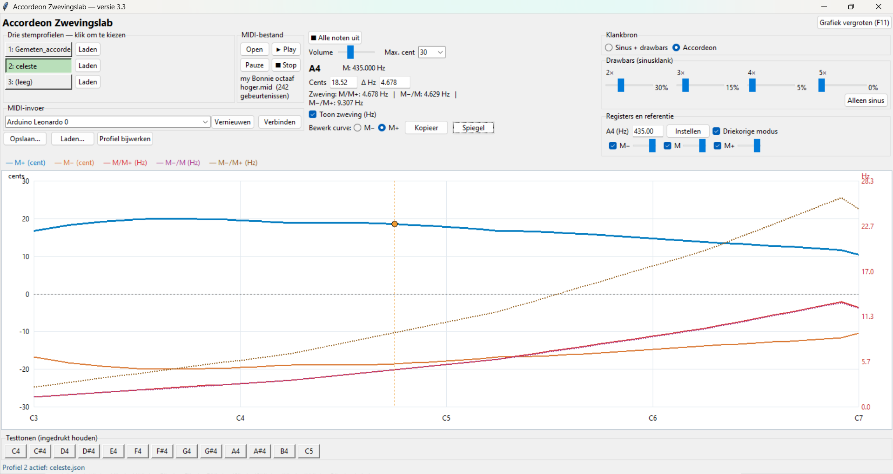

[README.md](https://github.com/user-attachments/files/35469963/README.md)
# Accordion-Tuning-Lab

**Explore the sound of accordion tuning, tremolo and musette.**

**[Download for Windows]**(https://github.com/Zwadke/Accordion-Tuning-Lab/releases/latest) · [Nederlands](LEESMIJ.txt) · [English manual](docs/Manual-EN.md) · [Nederlandse handleiding](docs/Handleiding-NL.md)

Accordion Tuning Lab is a free, open-source listening and simulation tool for accordion players, tuners and instrument makers. Draw tuning curves, compare different reed combinations and hear the result immediately. No physical accordion or MIDI keyboard is required.

*Screenshot of version 3.3 in Dutch. Version 3.4 also offers an English interface.*

## Features

- Two- and three-reed simulation (M−, M and M+), with individual reed levels.
- Editable tuning curves from C3 to C7, in cents or frequency deviation in Hz.
- Pairwise beating rates displayed in Hz alongside the tuning curves.
- Adjustable A4 reference pitch, including 435 and 440 Hz.
- Accordion-like synthesized timbre based on measured harmonic profiles, or sine tones with four harmonic drawbars.
- MIDI keyboard input, MIDI file playback and built-in test notes.
- Three profile slots for quick comparison; JSON import and export.
- English and Dutch interface; F11 expands the graph.

## Installation on Windows

1. Open [Releases](https://github.com/Zwadke/Accordion-Tuning-Lab/releases/latest).
2. Under **Assets**, download `Accordion_Tuning_Lab_Setup.exe` (not the source-code ZIP).
3. Run the installer and open Accordion Tuning Lab from the Start menu or desktop.

Python is not required for the installed version. The installer is unsigned and Windows may display a SmartScreen warning; verify that it came from this repository before proceeding.

## Quick start

Load `Celeste.json` into a profile slot and hold a test note. Enable **Three-reed mode** to explore musette tuning. Select M+, then click **Mirror** to create the opposite M− curve. Enable all three reeds and adjust their levels. Save your new profile under a different name.

The included `Measured_A435.json` reconstructs two measured reed curves relative to A4 = 435 Hz. Values outside the measured C4–B♭6 range use the nearest measured endpoint. These examples are not universal tuning recommendations.

This program simulates tuning; it does not measure microphone input or tune a physical accordion automatically.

## Development

For developers who want to run the source code or build their own installer, see [BUILD.md](BUILD.md).

Bug reports and suggestions are welcome through [Issues](https://github.com/Zwadke/Accordion-Tuning-Lab/issues).

## License

MIT — see [LICENSE](LICENSE). Third-party dependencies retain their own licenses; see [dependency notes](docs/Third-party.md).
